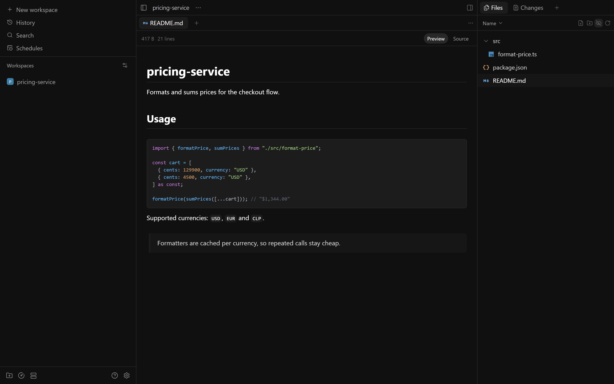
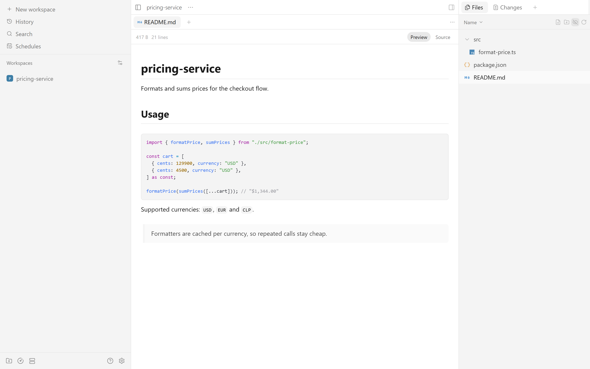

# Vesper for Paseo

Dark and light themes for [Paseo](https://paseo.sh) based on [Vesper](https://github.com/raunofreiberg/vesper): near-black or near-white surfaces, soft grey text and a single peach accent.

## Appearance





**Vesper Dark** sits on `#101010` with white text, `#A0A0A0` secondary text and a `#FFC799` peach accent. Cards, inputs and code blocks step up in small grey increments (`#161616`, `#1C1C1C`) with `#282828` borders, so the interface reads as one flat, quiet surface.

**Vesper Light** uses a white background with `#1A1A1A` text, `#777777` secondary text and a `#BD5B00` accent. Raised surfaces, inputs and code blocks use `#FAFAFA` and `#F4F4F4` with `#E8E8E8` borders.

**Vesper Light Mono** is the same light palette without an accent, so buttons, selection and focus use the text color.

Paseo draws text on accent-filled elements in the background color, which is white in light themes. The original Obsidian Vesper light accent `#FFB066` only reaches 1.8:1 against white, so Vesper Light keeps its hue at `#BD5B00` (4.5:1) and Vesper Light Mono drops it entirely.

| Token | Vesper Dark | Vesper Light | Vesper Light Mono |
| --- | --- | --- | --- |
| `background` | `#101010` | `#FFFFFF` | `#FFFFFF` |
| `foreground` | `#FFFFFF` | `#1A1A1A` | `#1A1A1A` |
| `raised` | `#161616` | `#FAFAFA` | `#FAFAFA` |
| `control` | `#1C1C1C` | `#F4F4F4` | `#F4F4F4` |
| `border` | `#282828` | `#E8E8E8` | `#E8E8E8` |
| `accent` | `#FFC799` | `#BD5B00` | none |
| `mutedForeground` | `#A0A0A0` | `#777777` | `#777777` |
| `ring` | `#707070` | `#AAAAAA` | `#AAAAAA` |

Code blocks use `control` as their background, `border` as their frame and `foreground` as base text. Syntax token colors come from the syntax theme selected in Paseo, and status colors (success, warning, danger) keep Paseo's defaults, because the plugin theme API does not expose them.

## Installation

Requires Paseo 0.11.0 or later with **Settings → Plugins → Enable plugins** turned on.

```sh
paseo plugin add alexeira/vesper-theme
```

The package is also available directly from npm:

```sh
paseo plugin add npm:@alexeira/paseo-vesper-theme
```

## Activation

Open **Settings → Appearance → Theme** and select **Vesper Dark**, **Vesper Light** or **Vesper Light Mono**. If the plugin is disabled or removed, Paseo falls back to its default theme.

## Development

```sh
npm install
npm run typecheck
paseo plugin install /absolute/path/to/paseo-vesper-theme
paseo plugin reload vesper-theme
```

## Credits

- [Vesper](https://github.com/raunofreiberg/vesper) by Rauno Freiberg, MIT License.
- [Obsidian Vesper](https://github.com/omarrashad/obsidian-vesper) by Omar Rashad, MIT License, source of the dark and light text, background and accent colors; the light accent is darkened for contrast.

Both upstream themes are MIT licensed; this plugin is MIT licensed as well. See [LICENSE](LICENSE).
